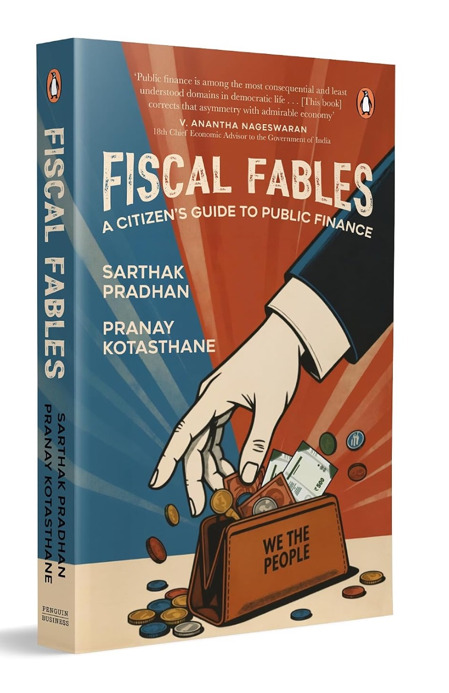

```{=html}
<script type="application/ld+json">
{
  "@context": "https://schema.org",
  "@graph": [
    {
      "@type": "Person",
      "@id": "https://pranaykotas.com/#pranay",
      "name": "Pranay Kotasthane",
      "url": "https://pranaykotas.com",
      "sameAs": [
        "https://www.wikidata.org/wiki/Q139565581",
        "https://takshashila.org.in/people/pranay-kotasthane",
        "https://www.linkedin.com/in/pranaykotas/",
        "https://www.amazon.in/stores/author/B0BSVH1PMC",
        "https://www.goodreads.com/author/show/15179068.Pranay_Kotasthane",
        "https://orcid.org/0009-0005-5078-5322",
        "https://scholar.google.com/citations?user=LPqHQ4AAAAAJ",
        "https://x.com/pranaykotas",
        "https://www.youtube.com/@puliyabaazi",
        "https://profile.google.com/@pranaykotas",
        "https://www.amazon.com/Pranay-Kotasthane/e/B0BSVH1PMC"
      ],
      "jobTitle": "Deputy Director",
      "worksFor": {
        "@type": "Organization",
        "name": "Takshashila Institution",
        "url": "https://takshashila.org.in"
      },
      "subjectOf": [
        { "@type": "NewsArticle", "url": "https://www.nytimes.com/2026/11/02/world/asia/china-us-exports-ai-solar.html" },
        { "@type": "NewsArticle", "url": "https://www.wsj.com/articles/indias-manufacturing-push-takes-an-audacious-gamble-on-chips-11670946984" },
        { "@type": "NewsArticle", "url": "https://www.wsj.com/opinion/indias-big-semiconductor-bet-e0e60891" },
        { "@type": "NewsArticle", "url": "https://www.wsj.com/opinion/does-india-even-have-any-cards-ba4b7010" },
        { "@type": "NewsArticle", "url": "https://www.economist.com/business/2024/06/20/indias-electronics-industry-is-surging" },
        { "@type": "NewsArticle", "url": "https://www.economist.com/finance-and-economics/2024/05/16/narendra-modis-flagship-growth-scheme-is-off-to-a-sluggish-start" },
        { "@type": "NewsArticle", "url": "https://www.economist.com/asia/2025/05/01/indias-new-chip-fab-rises-from-the-dust" },
        { "@type": "NewsArticle", "url": "https://www.straitstimes.com/world/china-export-ban-on-engineers-and-equipment-disrupts-manufacturing-overseas" },
        { "@type": "NewsArticle", "url": "https://www.straitstimes.com/asia/south-asia/calls-mount-to-redraw-electoral-boundaries-across-india-to-ensure-fair-representation" },
        { "@type": "NewsArticle", "url": "https://www.straitstimes.com/asia/south-asia/boring-war-china-cuts-tbm-exports-india-digs-in" },
        { "@type": "NewsArticle", "url": "https://www.scmp.com/week-asia/economics/article/3151284/india-courts-chip-makers-taiwan-and-quad-its-side-it-takes" }
      ]
    },
    {
      "@type": "Book",
      "@id": "https://pranaykotas.com/books/#missing-in-action",
      "name": "Missing in Action: Why You Should Care About Public Policy",
      "author": [
        { "@id": "https://pranaykotas.com/#pranay" },
        { "@type": "Person", "name": "Raghu S Jaitley" }
      ],
      "datePublished": "2023",
      "publisher": { "@type": "Organization", "name": "Penguin Random House India" },
      "isbn": "9780143459378",
      "inLanguage": "en",
      "sameAs": "https://www.wikidata.org/wiki/Q139565606",
      "url": "https://www.amazon.in/Missing-Action-Should-Public-Policy/dp/0143459376/"
    },
    {
      "@type": "Book",
      "@id": "https://pranaykotas.com/books/#when-the-chips-are-down",
      "name": "When the Chips Are Down: A Deep Dive into a Global Crisis",
      "author": [
        { "@id": "https://pranaykotas.com/#pranay" },
        { "@type": "Person", "name": "Abhiram Manchi" }
      ],
      "datePublished": "2023-12-21",
      "publisher": { "@type": "Organization", "name": "Bloomsbury Publishing" },
      "isbn": "9789356402454",
      "inLanguage": "en",
      "sameAs": "https://www.wikidata.org/wiki/Q139565634",
      "url": "https://www.amazon.in/When-Chips-Down-Pranay-Kotasthane/dp/9356402469/"
    },
    {
      "@type": "Book",
      "@id": "https://pranaykotas.com/books/#we-the-citizens",
      "name": "We, The Citizens: Strengthening the Indian Republic",
      "author": [
        { "@id": "https://pranaykotas.com/#pranay" },
        { "@type": "Person", "name": "Khyati Pathak" },
        { "@type": "Person", "name": "Anupam Manur" }
      ],
      "datePublished": "2024",
      "publisher": { "@type": "Organization", "name": "Penguin Random House India" },
      "isbn": "9780143463559",
      "inLanguage": "en",
      "sameAs": "https://www.wikidata.org/wiki/Q139565662",
      "url": "https://www.amazon.in/We-Citizens-Strengthening-Indian-Republic/dp/0143463551"
    },
    {
      "@type": "Book",
      "@id": "https://pranaykotas.com/books/#fiscal-fables",
      "name": "Fiscal Fables: A Citizen's Guide to Public Finance",
      "author": [
        { "@id": "https://pranaykotas.com/#pranay" },
        { "@type": "Person", "name": "Sarthak Pradhan" }
      ],
      "datePublished": "2026",
      "publisher": { "@type": "Organization", "name": "Penguin Business" },
      "isbn": "9789377303958",
      "inLanguage": "en",
      "sameAs": "https://www.wikidata.org/wiki/Q141043114",
      "url": "https://www.amazon.in/Fiscal-Fables-Citizens-Public-Finance/dp/9377303958"
    }
  ]
}
</script>
```

## About Me

I am a public policy researcher at the [Takshashila Institution](https://takshashila.org.in), where I work on India's public policy puzzles at the intersection of technology, economics, and geopolitics. I write [op-eds](op-eds/) and [blog posts](blog/), co-host the [Puliyabaazi](podcast.qmd) podcast and the [Watching the Wheels](podcast.qmd#watching-the-wheels) YouTube show, co-write the [Anticipating the Unintended](newsletter.qmd) newsletter, and [teach](courses.qmd) courses on public policy and geopolitics.

My work on technology geopolitics and public policy has been cited in *The New York Times* ([1](https://www.nytimes.com/2026/11/02/world/asia/china-us-exports-ai-solar.html)), *The Wall Street Journal* ([1](https://www.wsj.com/articles/indias-manufacturing-push-takes-an-audacious-gamble-on-chips-11670946984), [2](https://www.wsj.com/opinion/indias-big-semiconductor-bet-e0e60891), [3](https://www.wsj.com/opinion/does-india-even-have-any-cards-ba4b7010)), *The Economist* ([1](https://www.economist.com/business/2024/06/20/indias-electronics-industry-is-surging), [2](https://www.economist.com/finance-and-economics/2024/05/16/narendra-modis-flagship-growth-scheme-is-off-to-a-sluggish-start), [3](https://www.economist.com/asia/2025/05/01/indias-new-chip-fab-rises-from-the-dust)), *The Straits Times* ([1](https://www.straitstimes.com/world/china-export-ban-on-engineers-and-equipment-disrupts-manufacturing-overseas), [2](https://www.straitstimes.com/asia/south-asia/calls-mount-to-redraw-electoral-boundaries-across-india-to-ensure-fair-representation), [3](https://www.straitstimes.com/asia/south-asia/boring-war-china-cuts-tbm-exports-india-digs-in)), and the *South China Morning Post* ([1](https://www.scmp.com/week-asia/economics/article/3151284/india-courts-chip-makers-taiwan-and-quad-its-side-it-takes)).

```{=html}
<section class="book-feature" aria-label="New book: Fiscal Fables">
  
  <div>
    <div class="book-feature-title">Fiscal Fables</div>
    <div class="book-feature-sub">A Citizen's Guide to Public Finance, co-written with Sarthak Pradhan. Penguin Business, 2026.</div>
    <div class="book-feature-blurb">Freebies, GST disputes, the north–south fight over tax money, cities that can't pay their bills. Our new book explains the public finance behind these debates through stories and examples, for readers who aren't economists.</div>
    <div class="book-feature-actions">
      <a href="https://www.amazon.in/Fiscal-Fables-Citizens-Public-Finance/dp/9377303958" class="btn btn-primary" target="_blank" rel="noopener">Buy on Amazon</a>
      <a href="https://www.penguin.co.in/book/fiscal-fables/" target="_blank" rel="noopener">Penguin page</a>
      <a href="books.html">All my books</a>
    </div>
  </div>
</section>
```

## Latest Writing

Recent blog posts and newspaper op-eds.

::: {#latest-writing}
:::

```{=html}
<div class="home-more-links">
  <a href="blog/" class="btn btn-outline-primary">All blog posts</a>
  <a href="op-eds/" class="btn btn-outline-primary">All op-eds</a>
</div>
```

## Topics

I write on [Semiconductor Geopolitics](topics/semiconductor-geopolitics.qmd), [Critical Minerals](topics/critical-minerals.qmd), [Technology Geopolitics](topics/technology-geopolitics.qmd), [India Foreign Policy](topics/india-foreign-policy.qmd), [Public Policy](topics/public-policy.qmd), and [Public Finance](topics/public-finance.qmd) — each page collects my writing, talks, and papers on that theme.

## Ideas & Observations

::: {.grid}

::: {.g-col-6}
### [Big Ideas](big-ideas.qmd)
Claims, hypotheses, and frameworks I keep returning to — from the tyranny of context to why state capacity is a flow, not a stock.
:::

::: {.g-col-6}
### [Field Notes](field-notes/)
Short observations, quips, and insights worth preserving — on policy, geopolitics, cities, and the craft of research.
:::

:::

## Selected Projects

I also build public-interest research infrastructure: trackers, dashboards, directories, and tools that make policy questions easier to monitor, verify, and explain.

::: {.project-grid .home-projects}

::: {.project-card .featured}
### [India Semiconductor Manufacturing Tracker](https://fabs.pranaykotas.com)

::: {.project-meta}
Tracker
:::

Tracks India's semiconductor manufacturing facilities, milestones, investment, slippage, and technology complexity.
:::

::: {.project-card .featured}
### [AI for Public Policy Directory](https://aipublicpolicy.org)

::: {.project-meta}
Directory
:::

A searchable catalog of AI tools, dashboards, and projects built for public policy.
:::

::: {.project-card}
### [Frameworks for Public Policy](https://frameworks.pranaykotas.com)

::: {.project-meta}
Reference
:::

Plain-language public-policy frameworks and mental models for students, practitioners, and curious readers.
:::

::: {.project-card}
### [ParliamentWatch](https://parliamentcommittee.streamlit.app)

::: {.project-meta}
Tracker
:::

Browse, search, and generate AI-powered summaries of Indian Parliamentary Committee reports.
:::

:::

```{=html}
<a href="projects.html" class="btn btn-outline-primary">View all projects</a>
```

## Contact {#contact}

```{=html}
<p>
  To reach me by email:
  <a id="email-link" href="#"
     data-u="pranay"
     data-d="takshashila.org.in"
     onclick="this.href='mailto:'+this.dataset.u+String.fromCharCode(64)+this.dataset.d;"
     onmouseover="this.href='mailto:'+this.dataset.u+String.fromCharCode(64)+this.dataset.d;"
     onfocus="this.href='mailto:'+this.dataset.u+String.fromCharCode(64)+this.dataset.d;">
    pranay&nbsp;[at]&nbsp;takshashila.org.in
  </a>
</p>
```
